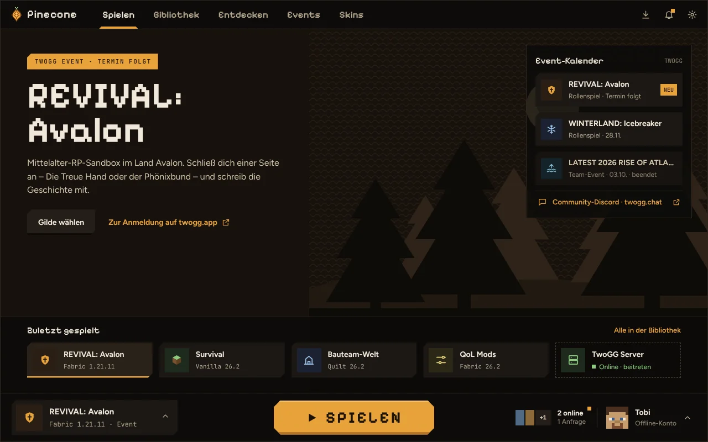
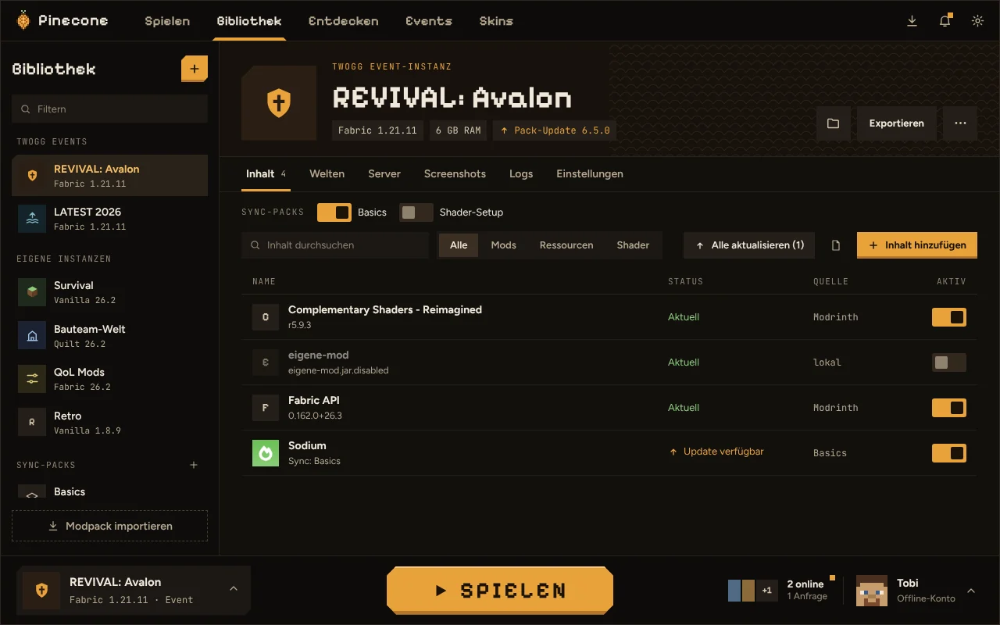
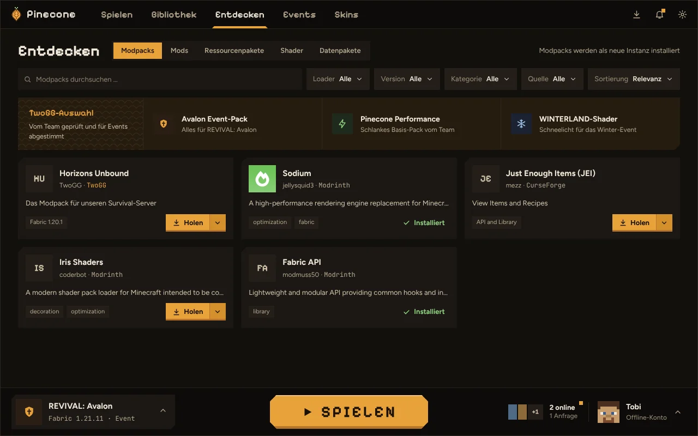
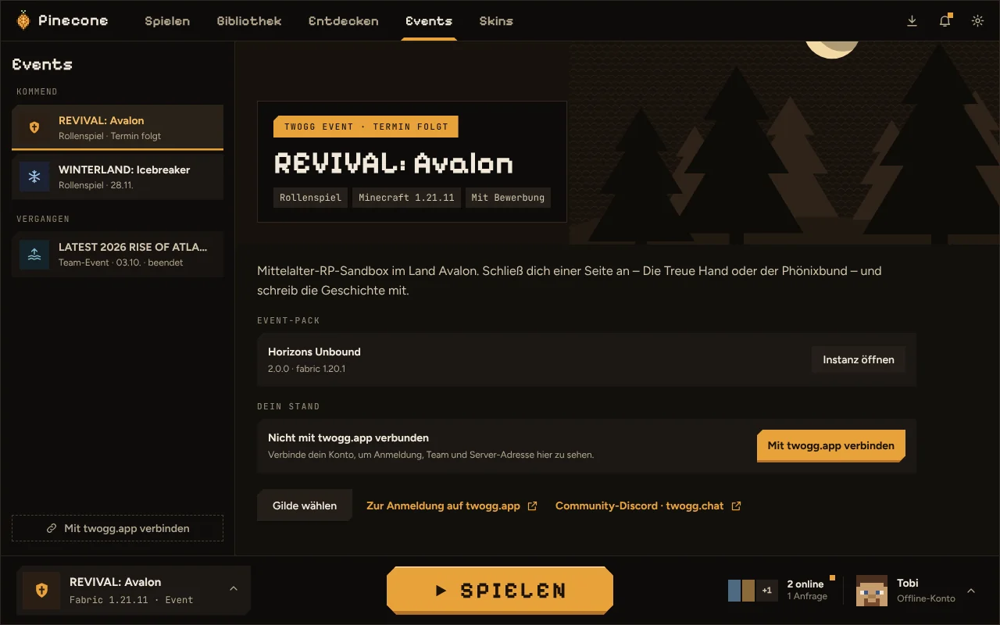
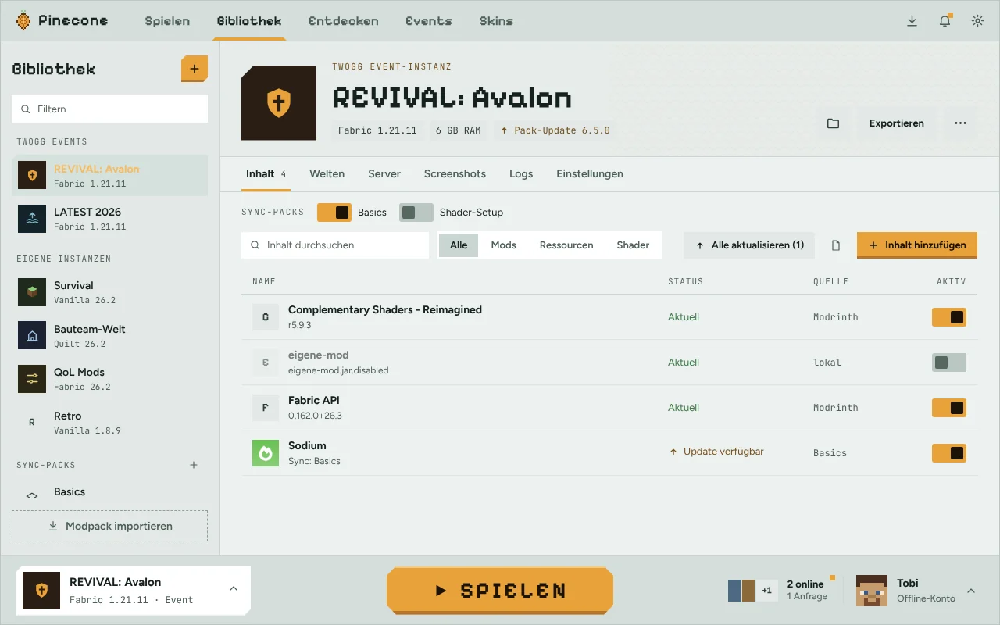

<div align="center">


# TwoGG Pinecone

**Der Minecraft-Launcher der TwoGG-Community.**<br>
Instanzen, Mods und Modpacks an einem Ort, dazu TwoGG-Events, Event-Packs und deine Freunde.

[](https://github.com/wheatley2056/twogg-pinecone/releases/latest)

[](#lizenz)

[**Herunterladen**](https://wheatley2056.github.io/twogg-pinecone/#download) ·
[Website](https://wheatley2056.github.io/twogg-pinecone/) ·
[Änderungen](CHANGELOG.md) ·
[Fehler melden](https://github.com/wheatley2056/twogg-pinecone/issues)

**Deutsch** · [English](README.en.md)

<br>



</div>

> [!NOTE]
> Pinecone ist in der **Beta**. Updates kommen automatisch, sobald eine neue Version erscheint.

## Funktionen

| | |
|---|---|
| 🎮 **Instanzen** | Jede Instanz hat ihren eigenen Spielordner mit Mods, Welten und Einstellungen. Vanilla, Fabric, Quilt, Forge oder NeoForge, jede Minecraft-Version. Java lädt Pinecone selbst. |
| 🔎 **Entdecken** | Modpacks, Mods, Ressourcenpakete, Shader und Datenpakete von Modrinth, CurseForge und TwoGG durchsuchen und mit einem Klick installieren, samt Abhängigkeiten. |
| 📦 **Modpacks** | Aus Datei oder Link importieren (`.mrpack`, CurseForge-ZIP). Updates legen vorher eine Sicherung an, deine eigenen Änderungen bleiben erhalten. |
| 🔁 **Version wechseln** | Eine Instanz auf eine andere Minecraft-Version oder einen anderen Loader umziehen. Pinecone sucht die passenden Mods dafür. |
| 🧩 **Sync-Packs** | Eigene Sammlungen wie „Basics“ einmal anlegen und in jeder Instanz per Schalter einschalten. Mit Freunden per Link teilen. |
| 🌍 **Welten & Server** | Welten sichern und wiederherstellen, auf Wunsch automatisch vor jedem Start. Server mit Live-Status, direkt beitreten. |
| 👕 **Skins** | Skin-Bibliothek mit 3D-Vorschau und Editor. Skin und Cape deines Kontos direkt aus dem Launcher setzen. |
| 🎨 **Dein Look** | Drei Themes (Rinde, Kiefer, Winterland), fünf Akzentfarben und reduzierte Animationen auf Wunsch. |

### Gemacht für TwoGG

- **Events:** Die Events von twogg.app im Launcher sehen, das passende Event-Pack mit einem Klick installieren und dem Event-Server direkt beitreten.
- **Freunde:** Sehen, wer online ist und was gespielt wird. Freunde per Spielername oder Freundescode hinzufügen und auf deinen Server einladen. Dein Status ist nur für Freunde sichtbar.
- **TwoGG-Auswahl:** Vom Team geprüfte Event-Packs, Performance-Packs und Shader oben in „Entdecken“. TwoGG-Modpacks gibt es nur über Pinecone.
- **Community-Server und Neuigkeiten** direkt auf der Startseite.
- **Discord-Status** „Spielt …“ auf Wunsch.

<table>
  <tr>
    <td></td>
    <td></td>
  </tr>
  <tr>
    <td></td>
    <td></td>
  </tr>
</table>

## Installation

Lade die passende Datei auf der [Website](https://wheatley2056.github.io/twogg-pinecone/#download) oder unter [Releases](https://github.com/wheatley2056/twogg-pinecone/releases/latest) herunter.

| System | Datei |
|---|---|
| **Windows 10 und 11** (64 Bit) | Installer `…-setup.exe` (empfohlen) oder `….msi` |
| **Linux** (x86_64) | `….AppImage` für alle Distributionen, `….deb` für Debian, Ubuntu und Mint, `….rpm` für Fedora und openSUSE |

<details>
<summary><b>Windows zeigt „Der Computer wurde durch Windows geschützt“</b></summary>

Der Installer ist noch nicht mit einem Zertifikat signiert. Klick auf **Weitere Informationen** und dann auf **Trotzdem ausführen**.
</details>

<details>
<summary><b>AppImage unter Linux starten</b></summary>

Nach dem Download ausführbar machen und starten:

```sh
chmod +x Pinecone*.AppImage
./Pinecone*.AppImage
```

Pinecone braucht WebKitGTK 4.1. Bei aktuellen Distributionen ist es dabei, sonst z. B. `sudo apt install libwebkit2gtk-4.1-0` oder `sudo pacman -S webkit2gtk-4.1`.
</details>

## Erste Schritte

1. **Anmelden:** Unter Einstellungen › Konten mit deinem Microsoft-Konto anmelden. Du brauchst eine eigene Minecraft: Java Edition.
2. **Instanz anlegen:** In der Bibliothek eine neue Instanz erstellen oder unter „Entdecken“ ein Modpack installieren.
3. **Spielen:** Instanz unten in der Spielleiste wählen und auf **SPIELEN** klicken.
4. **Optional:** Unter Einstellungen › TwoGG-Verknüpfung dein twogg.app-Konto verbinden, um deine Event-Anmeldungen zu sehen.

## Häufige Fragen

<details>
<summary><b>Kostet Pinecone etwas?</b></summary>

Nein. Pinecone ist kostenlos und Open Source. Du brauchst nur eine eigene Minecraft: Java Edition.
</details>

<details>
<summary><b>Brauche ich ein TwoGG-Konto?</b></summary>

Nein. Zum Spielen reicht dein Microsoft-Konto. Die Verbindung mit twogg.app ist optional und zeigt dir deine Event-Anmeldungen im Launcher. Die Freundesliste läuft über dein Minecraft-Konto.
</details>

<details>
<summary><b>Kann ich meine Modpacks von anderen Launchern mitnehmen?</b></summary>

Ja. Modrinth-Packs (`.mrpack`) und CurseForge-Packs (ZIP) lassen sich importieren, ebenso Links von Modrinth. Eigene Instanzen kannst du als `.mrpack` exportieren und teilen.
</details>

<details>
<summary><b>Wie bekomme ich Updates?</b></summary>

Pinecone prüft beim Start auf neue Versionen und installiert sie auf Wunsch. Updates sind signiert, der Launcher installiert nur Pakete von TwoGG.
</details>

<details>
<summary><b>Wo liegen meine Daten?</b></summary>

Unter Windows in `%APPDATA%\TwoGG\Pinecone`, unter Linux in `~/.local/share/twogg-pinecone`. Anmeldedaten speichert Pinecone im Schlüsselbund deines Systems, nicht in Dateien. Pinecone enthält keine Werbung und kein Tracking. Mehr dazu in der [Datenschutzerklärung](https://wheatley2056.github.io/twogg-pinecone/datenschutz.html).
</details>

<details>
<summary><b>Läuft das Spiel weiter, wenn ich den Launcher schließe?</b></summary>

Ja. Ob Pinecone beim Spielstart offen bleibt, sich minimiert oder schließt, stellst du unter Einstellungen › Allgemein ein.
</details>

## Hilfe und Fehler melden

Etwas funktioniert nicht? So helfen wir dir am schnellsten:

1. In Pinecone unter **Einstellungen › Allgemein › Hilfe & Diagnose** ein Diagnose-ZIP erstellen. Es enthält keine Kontodaten, Tokens werden entfernt.
2. Stürzt das Spiel ab, im Tab **Logs** der Instanz auf **Log teilen** klicken und den Link mitschicken.
3. Ein [Issue auf GitHub](https://github.com/wheatley2056/twogg-pinecone/issues) öffnen oder im TwoGG-Discord melden, mit kurzer Beschreibung, was du gemacht hast.

## Mitmachen

Pinecone ist Open Source. Wie du den Launcher selbst baust und wie er aufgebaut ist, steht in [docs/ENTWICKLUNG.md](docs/ENTWICKLUNG.md).

## Lizenz

Pinecone steht unter MIT oder Apache-2.0, nach Wahl ([LICENSE-MIT](LICENSE-MIT), [LICENSE-APACHE](LICENSE-APACHE)). Eingebundene Fremdkomponenten wie [skinview3d](https://github.com/bs-community/skinview3d), der [MC Skin Editor](https://github.com/eheikes/mc-skin-editor) und Schriften unter OFL behalten ihre Lizenzen.

[Impressum](https://wheatley2056.github.io/twogg-pinecone/impressum.html) · [Datenschutz](https://wheatley2056.github.io/twogg-pinecone/datenschutz.html) · [Privacy Policy](https://wheatley2056.github.io/twogg-pinecone/privacy.html)

<sub>Kein offizielles Minecraft-Produkt. Nicht von Mojang oder Microsoft genehmigt oder mit ihnen verbunden. Minecraft ist eine Marke von Mojang AB.</sub>
